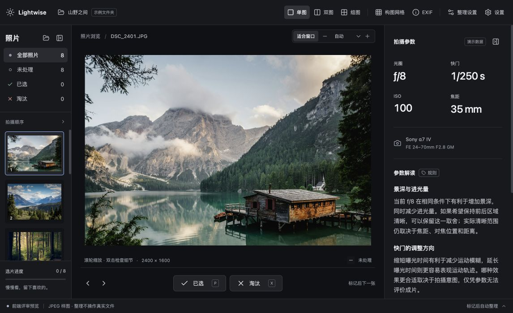
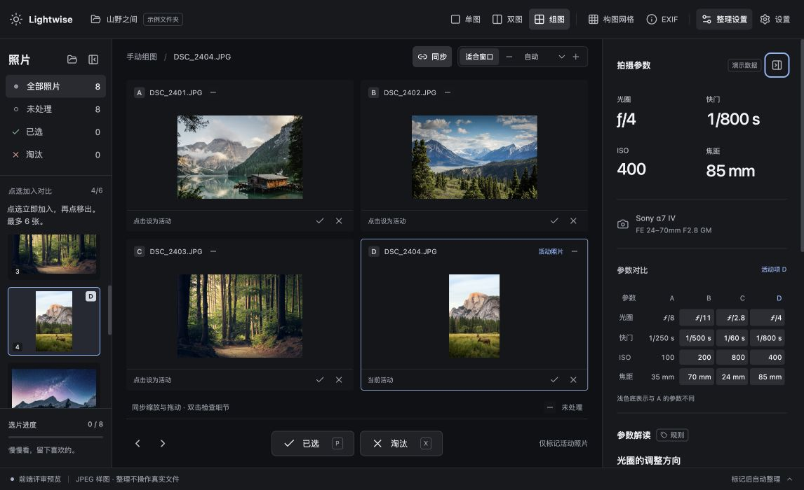

  

<h1 align="center">Lightwise · 光的智慧</h1>

<strong>Review your shots. Choose your keepers with ease.</strong>

  Revisit your camera settings and the choices behind each shot. 
  Compare, mark, and organize the photos you want to keep.

  
  
  
  

  <a href="./README.md">简体中文（默认）</a> · <strong>English</strong>

  <a href="https://hengchilde.github.io/Lightwise/">Website</a> · <a href="#features">Features</a> · <a href="#download">Get Lightwise</a> · <a href="#story">The story</a> · <a href="#feedback">Get in touch</a>

After a day of shooting, there are usually two things left to do: pick a favorite from several similar shots, and understand what your camera settings contributed to the result.

**Lightwise is a desktop tool that brings photo review and culling into one workspace.** See your photos, camera settings, and comparisons together, so choosing your keepers also becomes a chance to learn from the shoot.

## See the photo. Understand your choices.

Aperture, shutter speed, ISO, and focal length sit right beside the image. Settings and explanations follow as you move between photos, without repeatedly opening file information.

- **Connect the theory to your own shots.** Revisit the tradeoffs between aperture and depth of field, shutter speed and motion, or ISO and noise while looking at the result.
- **Go beyond the numbers.** Local, rule-based explanations help you interpret settings. Where applicable, exposure calculations suggest alternative combinations under the same lighting, giving you something to try next time.
- **Compare settings alongside images.** See parameter differences across selected photos and connect what you notice with how each shot was taken.

Explanations use the photo's EXIF data. The current version does not include AI image analysis, scene recognition, or image scoring, and it does not guess missing settings. You decide whether a photo works for what you wanted to express.

## Find your favorite, side by side

Travel scenes, portrait bursts, and repeated attempts at the same composition often differ only slightly. Put them beside each other to compare framing, expression, and detail before making your choice.

- **Single, dual, and grid views for up to six photos.** Start with the whole image, then manually bring together the shots you want to compare.
- **Synchronized zoom and pan.** Inspect details together, or turn synchronization off to explore each image independently.
- **More room for your photos.** A dark workspace and collapsible side panels help you focus; a composition grid provides a guide for reviewing framing.

## Mark it. Keep things organized.

Press `Z` for a keeper or `X` for a reject. Once you set a destination and organizing rules, each mark triggers the corresponding file operation, reducing the work of sorting everything again afterward.

- **Separate folders for picks and rejects.** Copy or move files according to your settings. Copying keeps the source original; moving removes the source after verifying the destination.
- **Keep going when you change your mind.** Updating a mark adjusts the files managed by the app. Task feedback shows progress, failures, and retry options.
- **Local photos, local processing.** Core browsing, culling, and parameter explanations work offline, without an account or uploading your photos for analysis.

| Shortcut  | Action                                 |
| --------- | -------------------------------------- |
| `↑` / `↓` | Previous / next photo (also `←` / `→`) |
| `Z` / `X` | Mark as picked / rejected              |
| `+` / `-` | Zoom in / out                          |
| `0`       | Fit to window                          |
| `G`       | Toggle composition grid                |
| `?`       | Show shortcuts                         |

## Get Lightwise

**Current version: Lightwise 0.1.4.** [Download the macOS Apple Silicon installer](https://github.com/HengChilde/Lightwise/releases/download/v0.1.4/Lightwise-0.1.4-arm64.dmg), or visit the [release page](https://github.com/HengChilde/Lightwise/releases/tag/v0.1.4) for release details.

See the [release notes](./CHANGELOG.md) for the first release and future updates (in Chinese).

| Item                        | Current support                                      |
| --------------------------- | ---------------------------------------------------- |
| Hardware                    | Mac with Apple Silicon (M-series chips)              |
| Photos                      | JPEG, HEIC / HEIF, PNG, WebP, AVIF, single-page TIFF |
| App interface               | Simplified Chinese                                   |
| Other platforms and formats | Intel Mac, Windows, and RAW are not supported        |

When you have the installer, open the DMG, drag Lightwise into Applications, and choose a photo folder. Confirm your organizing method and destination when marking your first photo, then continue selecting.

If macOS shows a warning on first launch, follow the illustrated `安装说明.png` inside the DMG. The included `安装命令.txt` contains the same command shown in the guide for easier copying.

Contact the developer if you run into installation issues. To update, quit the old version normally before replacing the app; selection records are stored locally. This English README introduces the product; the app does not yet have an English interface.

## It started with a trip to Xinjiang

Lightwise began with a Sony ZV-E10 and a trip to Xinjiang.

From Kashgar to the Pamir Plateau, there were mountains, lakes, and roads worth photographing again and again. As a beginner, I kept experimenting with aperture, shutter speed, and ISO. Back home, I had plenty of photos, too many similar shots to sort through, and a lot still to learn about the relationship between settings and results.

So I wanted to build something simple for myself: **review while selecting, compare shots together, and organize them as I go.**

Drawing on my years as a product manager, I defined the needs, narrowed the features, and worked through the interactions. With AI coding tools, the first prototype came together in an afternoon. Since then, I have continued refining it through actual use. That became Lightwise — a name that means “the wisdom of light.”

I wrote about the experience in _Back from a Trip, I Built Myself a Photography App_. I hope Lightwise helps other people who enjoy photography spend less time agonizing over selections and learn a little more from every shoot.

## Get in touch

Learning photography, or regularly choosing a few favorites from hundreds of shots? I would like to hear about your workflow and what gets in the way.

- Email: [hh@1000idea.com](mailto:hh@1000idea.com)

For bug reports, please include the app version, Mac chip and macOS version, steps to reproduce, and a screenshot of any error.

## About this repository

This repository contains the Lightwise website, product information, and public distribution materials. Desktop application source code is maintained separately. A public website repository does not mean the desktop app is open source.
